# De Números a Significado: Embeddings, Geometría Vectorial y Búsqueda Semántica en JAX

- **Por qué es relevante:** Todo sistema moderno de búsqueda semántica, RAG, recomendación y clasificación de intenciones transforma IDs discretos en vectores densos sobre una hiperesfera unitaria. Construir ese pipeline desde cero en JAX (`W_embed[token_ids]`, normalización L2, entrenamiento contrastivo `InfoNCE` con `jax.value_and_grad`, búsqueda exacta con `jnp.einsum` + `jax.lax.top_k` y clasificadores por centroides (`Zero-Shot`) y `Linear Probe`) desmitifica cómo las palabras y documentos adquieren significado geométrico.
- **Para quién es:** Ingenieros de software y desarrolladores que ya comprenden cómo aprende una red pequeña (Proyecto B2) y quieren entender cómo se entrenan, indexan y consultan `embeddings` de alta dimensión sin depender de cajas negras.
- **Quién debería verlo:** Equipos que diseñan motores de búsqueda vectorial, ruteadores de tickets de soporte, catálogos de productos o sistemas de recuperación de contexto y quieren ver qué pasa de verdad dentro de `W_embed[ids]`, `einsum` y `top_k`, con cifras medidas contra baselines justos.
- **Serie completa:** Tercera entrega de la Serie B [JAX & ML for Software Devs Field Guide](https://github.com/ykro/jax-ml-for-software-devs-field-guide) (compañera de la Serie A [JAX & OpenXLA Field Guide](https://github.com/ykro/jax-openxla-field-guide)).

---

## Arquitectura y Modelo Mental

### 1. De IDs Discretos a la Hiperesfera Unitaria (`Lookup Table`, Máscara y Normalización L2)

Representar un vocabulario de `32,000` tokens con vectores `one-hot` deja a todas las palabras ortogonales entre sí y, para un `batch` de `32 x 64` tokens, crea un tensor intermedio de `250 MiB` (`f32[32, 64, 32000]`) contra `1 MiB` de filas reunidas (`V / D = 250`, calculado de las formas). En JAX, indexar `W_embed[token_ids]` aparece en el Jaxpr real como una primitiva `gather` (el script lo imprime con `--show-ir`), da exactamente el mismo resultado que `one_hot @ W_embed` y su gradiente solo llega a las filas de los token IDs usados; la fila del `PAD` queda en cero gracias a la máscara.

![De IDs discretos a W_embed[token_ids], pooling con máscara y normalización L2](diagrams/01-discrete-ids-to-embedding-space.svg)

### 2. Cómo Aprende el Espacio Vectorial (`Contrastive Learning` e `InfoNCE`)

Un proyector inicializado al azar mezcla tickets de distintos dominios porque las palabras superficiales no coinciden exactamente. Al optimizar la función de pérdida contrastiva `InfoNCE` escalada por temperatura ($\tau = 0.08$) con `@jax.jit(jax.value_and_grad(infonce_loss))`, los gradientes acercan los pares positivos sobre la esfera unitaria y empujan los pares negativos. El `Recall@1` sobre los **16 pares de entrenamiento** pasa de `12.5%` (2 de 16) a `100.0%`; la prueba con tickets que el modelo nunca vio está en el experimento 05.



### 3. Motor de Búsqueda Vectorial Compilado (`jnp.einsum` + `jax.lax.top_k`)

Cuando los vectores del índice `(50000, 256)` y el `batch` de queries `(128, 256)` viven en la esfera unitaria, la `cosine similarity` de los `6.4 millones` de pares se reduce a una sola contracción matricial `jnp.einsum("qd,nd->qn", q_unit, index)` seguida de `jax.lax.top_k(scores, k=5)`, todo dentro de un solo programa compilado por XLA. Con `--show-ir` se ve lo que compiló de verdad en CPU: 4 fusiones (la última produce la matriz de scores `f32[128, 50000]`, que sí se materializa) y una llamada `TopK`.



---

## Resultados Reales de Verificación (`verify_embeddings.py`)

Este bloque lo reescribe `verify_embeddings.py` en cada corrida con los mismos valores que guarda en `benchmarks/latest_results.json`.

<!-- judge:start -->

Corrida del juez en Apple M1 Max (10 núcleos), Python 3.12.11, JAX 0.12.0.1, NumPy 2.5.4, backend `cpu`. Carga del sistema (load average de 1 min): 22.26 al empezar. Tiempos = mediana por llamada después de una llamada de calentamiento.

| Experimento | Baseline | JAX + OpenXLA | Speedup / Verificación | Baseline justo / nota |
| :--- | :--- | :--- | :--- | :--- |
| **01. Gather vs one-hot (jit)** | `47.19 ms` | `0.158 ms` | **298.1x** | 1.64x vs NumPy W[ids] |
| **02. jit cosine vs pair loop** | `95.31 ms` | `0.475 ms` | **200.6x** | 0.80x vs NumPy matmul |
| **03. InfoNCE, 16 train pairs** | `12.5% R@1` | `100.0% R@1` | **+0.658 margin** | chance 6.25% R@1 |
| **04. jit top-k vs query loop** | `1238.3 ms` | `15.89 ms` | **77.9x** | 3.75x vs NumPy batched |
| **05. Centroids & linear probe** | `7/12 acc` | `12/12 acc` | **probe 12/12** | untrained enc, 12 unseen |

Salida íntegra de terminal generada por `verify_embeddings.py`:

```text
==================================================================================================
THE OUTSIDE JUDGE — Embeddings & Semantic Search in JAX Verification Report
==================================================================================================
Runtime : Python 3.12.11 | JAX 0.12.0.1 | NumPy 2.5.4 | Backend: cpu
CPU     : Apple M1 Max (10 cores) | 1-min load average 22.26 before, 20.43 after
--------------------------------------------------------------------------------------------------
Experiment                   | Baseline   | JAX        | Speedup/Check | Fair baseline / note
--------------------------------------------------------------------------------------------------
01. Gather vs one-hot (jit)  | 47.19 ms   | 0.158 ms   | 298.1x        | 1.64x vs NumPy W[ids]
02. jit cosine vs pair loop  | 95.31 ms   | 0.475 ms   | 200.6x        | 0.80x vs NumPy matmul
03. InfoNCE, 16 train pairs  | 12.5% R@1  | 100.0% R@1 | +0.658 margin | chance 6.25% R@1
04. jit top-k vs query loop  | 1238.3 ms  | 15.89 ms   | 77.9x         | 3.75x vs NumPy batched
05. Centroids & linear probe | 7/12 acc   | 12/12 acc  | probe 12/12   | untrained enc, 12 unseen
--------------------------------------------------------------------------------------------------
Times: median per call after a warmup; they vary run to run and with machine load.
Saved JSON report to: benchmarks/latest_results.json
ALL DETERMINISTIC CHECKS PASSED.
```

<!-- judge:end -->

### Cómo leer estas cifras

- **Qué es mediana tras calentamiento.** Cada tiempo es la mediana de varias llamadas, medida después de una primera llamada que traza y compila y que no se cuenta. Las llamadas a JAX terminan en `block_until_ready()` para medir el cálculo completo y no solo el *dispatch* asíncrono.
- **Dos baselines por speedup.** La columna *Speedup* compara contra el baseline ingenuo de cada experimento (el one-hot, el loop de pares en Python, el loop por query). La columna *Baseline justo* compara contra la misma matemática bien escrita en NumPy, sin JAX. En CPU y con estos tamaños, el gather y el coseno quedan cerca del empate frente a NumPy bien escrito (en nuestras corridas, entre 0.3x y 1.9x según la carga de la máquina; NumPy también usa BLAS y son operaciones de menos de 2 ms). La búsqueda Top-K es donde el programa compilado de JAX saca una ventaja consistente, de unas 2 a 4 veces. La mayor parte de los speedups grandes viene de quitar loops de Python y de no materializar el one-hot, no de JAX por sí solo.
- **Qué aporta JAX entonces.** El mismo código corre sin cambios en GPU y Cloud TPU, se puede derivar (`jax.grad` atraviesa el `gather` y entrena el experimento 03) y se compone con `vmap` y `jit`. Esa es la ventaja que estos experimentos muestran; la velocidad en CPU frente a NumPy bien escrito es parecida.
- **Throughput no es latencia.** Los microsegundos «por query» del experimento 04 son el tiempo del batch de 128 dividido entre 128. Una query sola, compilada y medida aparte (línea `1 Query Alone (latency)`), tarda bastante más porque igual recorre los 50,000 vectores del índice.
- **Compilar no se cuenta dos veces.** La primera llamada a una función con `@jax.jit` traza y compila; el experimento 03 la reporta aparte (`First Call (trace+compile)`) y los tiempos de entrenamiento empiezan después.
- **El baseline ingenuo del 04 es débil a propósito.** Normaliza el índice completo dentro de cada llamada, recorre las queries en un loop de Python y ordena los 50,000 puntajes con `argsort` para quedarse con 5. Por eso está al lado el baseline en batch.
- **Las métricas de calidad son de juguete.** El `Recall@1` del experimento 03 se mide sobre los mismos 16 pares con los que se entrena (azar = 6.25%). El experimento 05 evalúa 12 tickets nuevos, así que cada ticket vale 8.3 puntos; los tickets reutilizan vocabulario de los dominios de entrenamiento y las features tienen una señal de dominio hecha a mano (`DOMAIN_CLUSTERS`).
- **Centroides «Zero-Shot».** El clasificador por centroides no entrena ningún parámetro, por eso se le suele llamar zero-shot, pero sí usa los 32 ejemplos etiquetados para armar los prototipos de clase. En sentido estricto es un clasificador *few-shot* por prototipos.
- **Variabilidad.** Las verificaciones (paridad, gather, gradiente, Recall@1, Top-K exacto) son deterministas. Los tiempos cambian entre corridas y con la carga de la máquina; el juez registra el modelo de CPU y el *load average* al empezar y al terminar. Son cifras de una sola corrida: tómalas como orden de magnitud, no al decimal.

---

## Estructura del Repositorio

```text
.
├── benchmarks/
│   ├── latest_results.json                             # Métricas de la última corrida de verify_embeddings.py
│   ├── terminal_output.txt                             # Salida íntegra del Outside Judge
│   └── experiment_outputs/                             # Salida de cada experimento (make experiments)
├── diagrams/
│   ├── 01-discrete-ids-to-embedding-space.{html,svg,png}
│   ├── 02-contrastive-infonce-geometry.{html,svg,png}
│   └── 03-jit-einsum-vector-search.{html,svg,png}
├── experiments/
│   ├── 01_tokens_to_embedding_table.py                 # W_embed[ids] (gather) vs one-hot matmul, máscara y --show-ir
│   ├── 02_cosine_similarity_and_vector_space.py        # Geometría L2, invarianza a longitud y einsum en @jax.jit
│   ├── 03_training_contrastive_embeddings.py           # Entrenamiento contrastivo InfoNCE con jax.value_and_grad
│   ├── 04_jit_vector_search_engine.py                  # Búsqueda Top-K sobre 50,000 vectores con einsum + lax.top_k y --show-ir
│   └── 05_zero_shot_and_linear_probe_classifier.py     # Clasificación por centroides (Zero-Shot) vs Linear Probe
├── gcp/
│   └── run_on_demand_embeddings.sh                     # Runner on-demand con auto-teardown en Cloud TPU v5e y L4 GPU
├── tests/
│   └── test_embeddings.py                              # Suite pytest determinista (5 tests)
├── Makefile
├── pyproject.toml
└── verify_embeddings.py                                # El Outside Judge (paridad, gather, Recall@1, Top-K exacto y tiempos)
```

---

## Onboarding Paso a Paso

### 1. Instalación desde cero (macOS / Linux)

```bash
git clone https://github.com/ykro/embeddings-and-semantic-search-in-jax.git
cd embeddings-and-semantic-search-in-jax
python3 -m venv .venv
source .venv/bin/activate
pip install --upgrade pip
pip install -e ".[dev]"
```

### 2. Recorrido guiado por los 5 experimentos (Orden recomendado)

Cada script tarda unos segundos (los baselines con loops de Python son los lentos) y construye un bloque fundamental del sistema de `embeddings` y búsqueda semántica:

```bash
# Paso 1 — De IDs discretos a W_embed[token_ids] (gather), máscara de padding y el one-hot de 250 MiB que evita
python experiments/01_tokens_to_embedding_table.py --show-ir

# Paso 2 — Geometría del significado: por qué falla la distancia euclidiana y cómo normalizar en la esfera L2
python experiments/02_cosine_similarity_and_vector_space.py

# Paso 3 — Cómo aprende el espacio vectorial: pérdida contrastiva InfoNCE en español (Recall@1 en los 16 pares de entrenamiento)
python experiments/03_training_contrastive_embeddings.py

# Paso 4 — Motor de búsqueda vectorial en JAX: 128 queries contra 50,000 vectores con einsum + lax.top_k
python experiments/04_jit_vector_search_engine.py --show-ir

# Paso 5 — Clasificación de intenciones sin reentrenar el encoder: centroides (Zero-Shot) vs Linear Probe en 12 tickets nuevos
python experiments/05_zero_shot_and_linear_probe_classifier.py
```

### 3. Verificación completa (Linter + Tests + Outside Judge)

```bash
# Ejecutar únicamente el Outside Judge y actualizar benchmarks/latest_results.json
python verify_embeddings.py

# Ejecutar ruff, pytest (5 tests) y verify_embeddings.py en un solo comando
make all

# Correr los 5 experimentos y guardar cada salida en benchmarks/experiment_outputs/
make experiments
```

### 4. Ejecución on-demand con auto-teardown en Google Cloud (Cloud TPU v5e o NVIDIA L4 GPU)

El script `gcp/run_on_demand_embeddings.sh` aprovisiona instancias on-demand con auto-teardown en el proyecto `ai-experiments-487722` y garantiza la eliminación inmediata de recursos mediante `trap cleanup EXIT INT TERM`.

```bash
# Ejecutar benchmark en una instancia on-demand de Cloud TPU v5e-1 (us-central1-a)
make gcp-tpu

# Ejecutar benchmark en un Vertex AI Custom Job on-demand con GPU NVIDIA L4
make gcp-gpu
```
